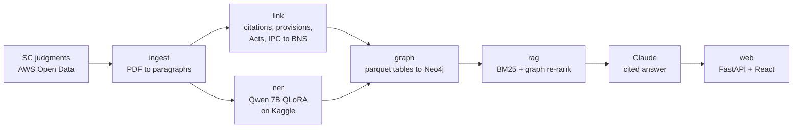

# Nyayagraph

A legal research assistant for Indian Supreme Court criminal appeals. Ask a question in plain language; it answers
from 2,037 judgments (2016-2025), and every claim cites the case and the paragraph it came from. Click a citation
and the paragraph opens with the quoted words highlighted.

Under the hood it is a knowledge graph built from the judgment PDFs: cases, paragraphs, precedents, statutory
provisions, judges, lawyers, lower courts and witnesses, extracted with a fine-tuned 7B LLM, a citation parser and
fuzzy + LLM entity linking, stored in Neo4j and searched with GraphRAG. It also bridges the 2024 criminal-law
reform: a question about BNSS s.528 finds the case law on CrPC s.482, and the answer shows the correspondence it
used.

## Results

| component | measured on | result |
|---|---|---|
| NER, Qwen2.5-7B QLoRA r16 | InLegalNER test, 13,365 entities | strict F1 **0.879** (InLegalBERT 0.856, zero-shot Qwen 0.334); +0.023 over the encoder, 95% CI [+0.015, +0.030] |
| Precedent linking, fuzzy + Claude Haiku | 600 hidden "(supra)" citations | precision 0.980, recall 0.913 (fuzzy alone 0.998 / 0.848) |
| Retrieval, BM25 + graph bridge | 279 test questions from SCR headnotes | MRR 0.640, gold paragraph in top 10: 0.817; +0.118 MRR over the first setup |
| Answers, Claude Opus 5.5 | 10 logged answers, deterministic checks | 120 of 131 cited passages are word-for-word text of the cited paragraph, 0 misattributed; 5 of 5 quotations exact |

Details, ablations and caveats: [`results/`](results/). Two findings worth noting:

- **Dense retrieval lost.** On this benchmark BM25 beat `bge-base` embeddings by 0.255 MRR, and adding dense to
  BM25 at any weight lowered MRR. A cross-encoder reranker looked +5 points on dev and did not replicate on test.
  Both are off by default ([`results/rag_bench.md`](results/rag_bench.md)).
- **Fine-tuning is the whole NER story.** Zero-shot, the same 7B model invents labels and paraphrases spans; one
  epoch of QLoRA on a T4 takes it from 0.33 to 0.88 and past the domain encoder, mostly on party roles and case
  numbers, where it reads the whole preamble instead of a 256-token window
  ([`results/ner_qlora.md`](results/ner_qlora.md)).

## Pipeline



| stage | what it does | code |
|---|---|---|
| ingest | Downloads criminal-appeal PDFs from the public `indian-supreme-court-judgments` S3 bucket; caches line geometry once (PDFs are never reopened); strips headers, margin letters and footnote markers; splits into paragraphs following the judgment's own numbering. 57,314 paragraphs. | `ingest/` |
| citations | Regex parser for SCC, SCC (Cri), SCC OnLine, SCR, AIR, INSC and Cri LJ citations, with parallel citations grouped as one case. | `link/citations.py` |
| precedent linking | Name mentions ("Leela Ram (supra)") linked by rapidfuzz against the cases the judgment cites; ambiguous ones go to Claude Haiku with the top 5 candidates. Decisions are cached, so the graph builds offline and deterministically. | `link/resolve.py` |
| provisions | "Sections 302, 307 r/w 34 IPC" to three provisions; resolves "the Code" and "the Act" from the judgment's own definitions; normalises Act spellings (816 to 598 Acts). | `link/provisions.py`, `link/acts.py` |
| old to new law | IPC to BNS, CrPC to BNSS and Evidence Act to BSA correspondence from published comparison tables (IPC to BNS cross-checked against a second source). 832 mappings. | `link/ipc_bns.py`, `link/law_map.py` |
| NER | InLegalBERT baseline and Qwen2.5-7B QLoRA (r8, r16) trained on InLegalNER on Kaggle T4s; vLLM inference over our own judgments. Predicted strings are aligned back to the source text, so nothing the model invents reaches the graph. | `ner/` |
| graph | Parquet tables, then an idempotent batched load into Neo4j; PageRank and Louvain on the citation graph (GDS). | `graph/` |
| retrieval | BM25 over ~200-word chunks; the graph re-ranks paragraphs that invoke the old-Act counterpart of a new-Act section in the question, or cite a case the question names; cited precedents are pulled in through `CITES`. | `rag/retrieve.py` |
| answer | Claude Opus 5.5 with each paragraph as a `search_result` block, so citations are native and point at `case_id ¶para`. Every answer is logged with its sources and usage. | `rag/ask.py` |
| web | FastAPI streams the answer (server-sent events); React shows it with numbered citations, a source panel, and full case pages. | `api/`, `web/` |

## The graph

```
(:Case)-[:CITES {paras}]->(:Case)                 15,339   in-corpus and cited-only cases
(:Case)-[:INVOKES {paras}]->(:Provision)          19,754
(:Provision)-[:PART_OF]->(:Act)
(:Provision)-[:MAPS_TO]->(:Provision)                832   IPC -> BNS, CrPC -> BNSS, IEA -> BSA
(:Case)-[:HAS_PARAGRAPH]->(:Paragraph)            57,314
(:Judge)-[:AUTHORED|SAT_ON]->(:Case)
(:Case)-[:DECIDED_BY]->(:Court)
(:Case)-[:APPEAL_FROM {bench, date}]->(:Court)     1,949   lower court, from NER
(:Lawyer)-[:APPEARED_IN {side, senior}]->(:Case)  22,736   from NER
(:Witness {pw})-[:WITNESS_IN {paras}]->(:Case)     4,416   numbered prosecution witnesses, from NER
```

8,219 Case nodes: 2,037 judgments in the corpus and 6,182 cases they cite.

## Run it

Needs Python 3.11, Node 20+, Neo4j 5 (with the GDS plugin for `graph.algos`) and an Anthropic API key. Data is
not in the repository; everything under `data/` is rebuilt by the pipeline and cached, except the reviewed
section-correspondence tables in `data/ref/`.

```bash
python -m venv .venv && source .venv/bin/activate
pip install -r requirements.txt
printf 'NEO4J_PASSWORD=...\nANTHROPIC_API_KEY=...\n' > .env
```

Build the corpus and graph:

```bash
python -m ingest.fetch --years 2016 2025
python -m ingest.pdf_to_text
python -m ingest.chunk
python -m link.citations
python -m link.provisions
python -m link.resolve --llm     # optional: Haiku tie-breaks for name linking, cached; graph.build only reads the cache
python -m graph.build
python -m graph.load
python -m rag.embed
```

NER over the corpus runs on a Kaggle GPU (`ner/train_qlora.py` and `ner/infer_vllm.py` have the notebook steps in
their docstrings). The inputs come from `python -m ner.corpus_inputs`; once the outputs are back in
`data/ner_corpus/`, `python -m ner.corpus_entities` turns them into graph tables.

Ask from the command line, or start the web app:

```bash
python -m rag.ask "When can a conviction rest solely on circumstantial evidence?"
```

```bash
uvicorn api.server:app --port 8000
npm --prefix web install && npm --prefix web run dev
```

Evaluate:

```bash
python -m pytest tests
python -m eval.ner_f1 data/instruct/test.jsonl data/preds/preds_r16.jsonl
python -m eval.rag_bench
python -m eval.answer_checks
```

## Limitations

- **Corpus:** Supreme Court criminal appeals 2016-2025 only. Cited older judgments exist as nodes with names and
  citations, not text.
- **The retrieval benchmark is a lower bound.** Only the source judgment counts as correct, though other
  judgments often state the same rule. Questions are written from headnote text, which favours BM25.
- **Section correspondence is section to section.** Where one old section split across several new ones,
  sub-section detail comes from the table's sub-section column only.
- **Extracted entities are not hand-checked at scale.** About 1-2% of witnesses carry a wrong PW number or are not
  people ("Reliance"); spot checks are in the commit history and `results/`.
- **Answers depend on retrieval.** When the paragraph that states a rule is not retrieved, the answer can only
  say what the retrieved paragraphs say.
